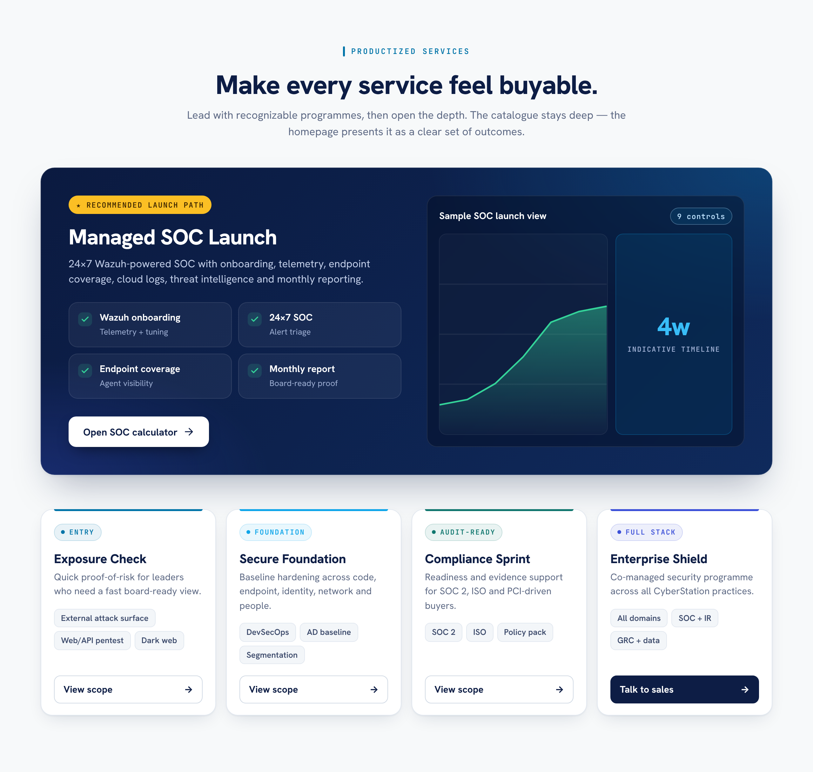
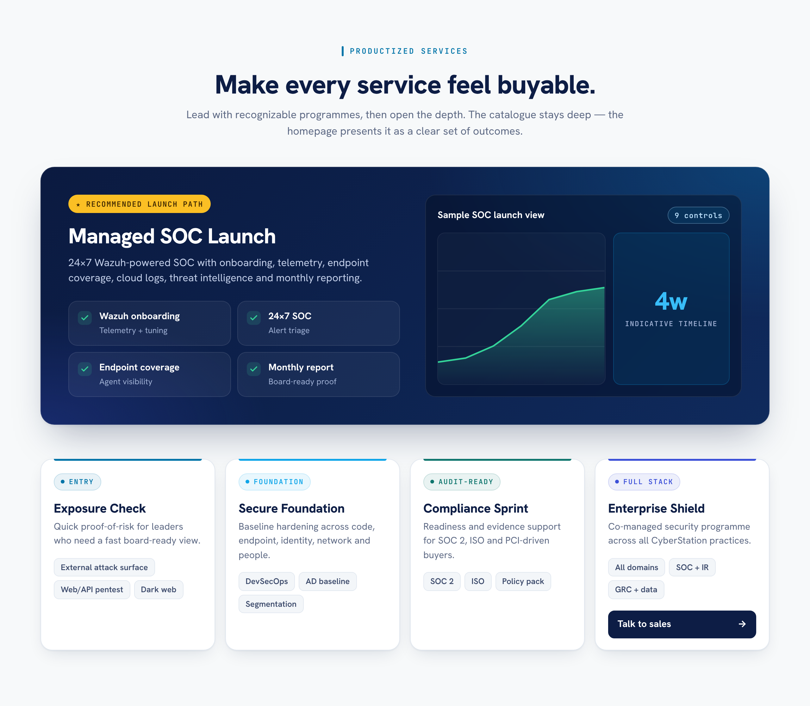
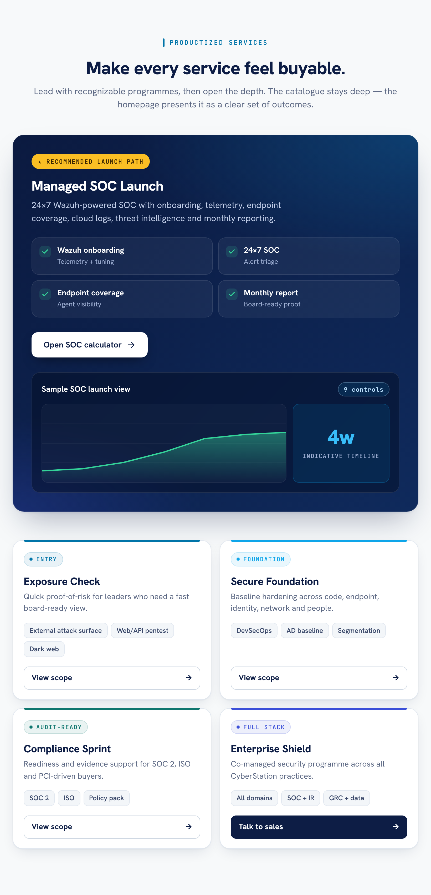
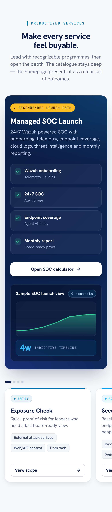

# "Productized services" section redesign

Interactive HTML mockup (no build step). Open `index.html` in a browser.
**Content rule:** every word comes from the live `#programmes` section. Nothing was added or removed.

The toolbar switch reproduces the live site's `data-pricing-hidden` behaviour. On the live site, the
"Open SOC calculator" and three "View scope" buttons are currently hidden by that flag.

## Screenshots

| Desktop | Desktop, pricing buttons hidden (live state) |
|---|---|
|  |  |

| Tablet | Phone |
|---|---|
|  |  |

## What changed (layout and styling only)

1. **Recommended programme is a full-width card.** Managed SOC Launch spans the row: text, tiles and button on the left, the sample view on the right. The four other programmes are no longer squeezed into a 2×2 block beside it.
2. **The four programmes share one card structure:** pill, title, description, tags, then the button pinned to the bottom so all four line up.
3. **Colour per programme.** The live `data-home-card-tone` 0–3 values each get one colour (top bar and pill).
4. **Readable tags.** The live source text is already sentence case, so the CSS no longer forces uppercase, and tags are 13px chips instead of tiny monospace.
5. **SOC tiles get check icons**, so they read as what's included rather than as plain boxes.
6. **The 4w timeline and "9 controls" are given more weight** in the sample view.
7. **Enterprise Shield's "Talk to sales" is a filled button.** It's the only button that's always visible, and it's the route for custom requirements.
8. **Phone layout:**
   - The four programmes become a swipeable row with the next card peeking in, plus dot navigation.
   - Section height drops from about 2,000px to about 1,700px.
   - Feature tiles stack in one column below 430px.
   - The SOC button is full width.
9. **Accessibility:**
   - Each button's screen-reader name includes the package (e.g. "View scope: Exposure Check").
   - The decorative chart is hidden from screen readers (`aria-hidden`).
   - Dots are labelled buttons.
   - Focus outlines are visible.
   - Motion is switched off for visitors who ask for reduced motion.
10. **Button handlers are unchanged:** `applyPackage('soc',true); route('calc')`, `startOrder('exposure'|'foundation'|'compliance')`, `startCall('enterprise')`. In the mockup they show a message naming the handler.

## Open points (content decisions, not changed here)

- The heading and subtitle read like an internal design brief, not copy for buyers.
- "9 controls" conflicts with the "What we do" section, which lists MDR with 1 control.
- With pricing hidden, three programme cards have no action at all.
- The Entry → Foundation → Audit-ready → Full stack labels suggest a sequence. Confirm whether to show it as steps.
