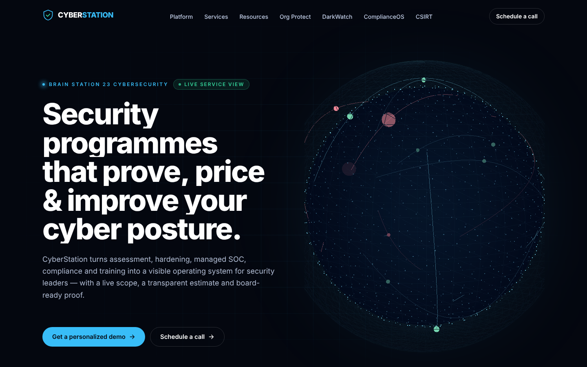

# CyberStation website (motion homepage)

A dark, motion-led homepage for CyberStation, built with the same kind of stack as award-winning
scroll sites. **All copy is the live site's own content** (`content/home.ts`). Nothing was reworded.



Scroll-through video: [`docs/scroll-preview.mp4`](docs/scroll-preview.mp4)

## Stack

| Layer | Tool |
|---|---|
| Framework | Next.js 16 (App Router, static output), React 19, TypeScript (strict) |
| Styling | Tailwind CSS 4 (`@theme` tokens in `app/globals.css`) |
| Scroll motion | GSAP 3 + ScrollTrigger + SplitText (`@gsap/react` `useGSAP`) |
| Smooth scroll | Lenis, driven by GSAP's ticker |
| 3D | React Three Fiber + three.js (hero globe only, loaded in the browser on demand) |
| Font | Gilroy only (see `public/fonts/README.md`) |

## Run it

```bash
npm install
npm run dev        # http://localhost:3000
npm run build && npm start
```

## Sections and motion

| Section | Motion |
|---|---|
| Intro | Shield draws itself, then the curtain lifts (~1.3s). Skipped on repeat visits and for reduced-motion visitors. The page renders underneath, so it never blocks content. |
| Hero | Headline reveals line by line. WebGL threat globe: packets travel along arcs, and hostile (red) packets get intercepted mid-flight. Pointer parallax. |
| Live feed | Two counter-scrolling rows of the live SOC events. Hovering pauses them. |
| Clients | Logo-name marquee. |
| Buyer problem | **Pinned scroll scene.** The five problems and the "noise" phrases float scattered; the noise gets struck through, the cards pull into the centre and become the CyberStation console line. |
| Approach | **Pinned horizontal scroll** through the 4 steps, with a progress bar. |
| Stats | Numbers count up. |
| Managed SOC | Live console card with a radar sweep (pure CSS), status tags and SLA metrics. |
| Threat landscape | Big numbers count up. |
| CTA + footer | Headline reveal, glow grid. |

## Built-in safeguards

- **Reduced motion:** every animation is gated by `prefers-reduced-motion`. Lenis, the globe and the intro are off, and content shows statically.
- **No content behind JavaScript:** text is server-rendered; animations start from the final state, so search engines and no-JS visitors see everything.
- **Performance:**
  - The globe loads only in the browser, in its own chunk.
  - It uses fewer points and a lower pixel ratio on phones and low-core devices.
  - It stops rendering when scrolled off-screen.
  - The marquees and radar are CSS-only.
- **Phones:** pinned scenes turn off below 1024px and become simple reveals. Checked at 390px with no sideways scrolling.
- **Accessibility:** skip link, a menu button with `aria-expanded` that closes on Escape, decorative visuals hidden from screen readers, and visible focus outlines.

## To do / open points

- **Gilroy files** must be added to `public/fonts/` (licensed font, not committed).
- **Logo:** `components/Logo.tsx` is a text stand-in. Swap in the official SVG.
- **Nav links** point to in-page anchors; wire them to the real routes.
- **Accessibility-only text** (not visible on screen): "Skip to content" and "Open/Close menu" are new strings, added for keyboard and screen-reader users.
