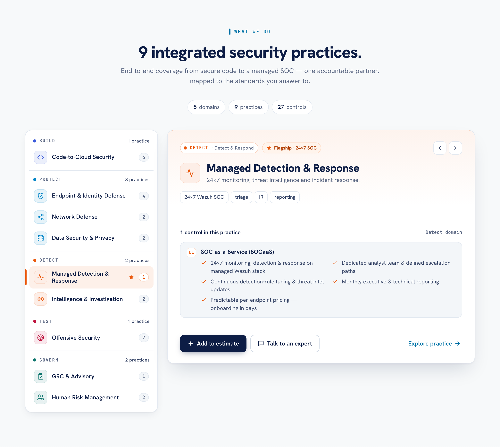
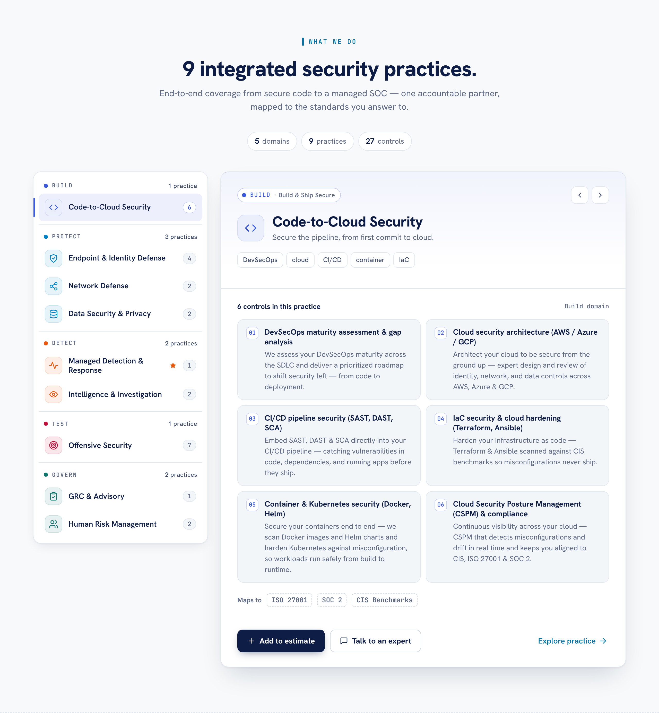
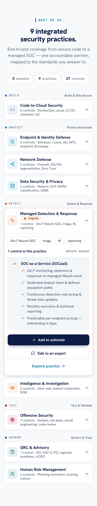

# "What we do" section redesign

A self-contained, interactive HTML mockup (no build step). Open `index.html` in a browser.
All copy, practices and the 27 controls come from the live section; nothing was removed.

## Screenshots

| Desktop: MDR selected on load | Desktop: Code-to-Cloud selected | Phone |
|---|---|---|
|  |  |  |

## What changed

1. **Grouped by the site's 5 domains:** Build, Protect, Detect, Test, Govern. This matches the "Service architecture" section, so the page uses one structure throughout.
2. **List and details side by side (desktop):** choosing a practice swaps the details panel. The page doesn't jump, and switching takes one click.
3. **Flagship opens first:** Managed Detection & Response is selected on load and labelled "Flagship".
4. **Colour means domain:** before, border colours cycled by column.
5. **01–09 badges removed:** they suggested an order that doesn't exist.
6. **Keywords shown as chips:** the same words, easier to scan.
7. **Steps shown as checklists:** the single MDR and GRC controls each contain 5 steps.
8. **"Maps to" standards:** taken from each practice's own copy (CIS, ISO 27001, SOC 2, OWASP, MASVS).
9. **A next step in every practice:** Add to estimate (`?service=<data-service-id>`), Talk to an expert (`#orgDemoModal`), Explore practice.
10. **Accessibility:** real buttons with `role="tab"`, `aria-controls`, and Arrow/Home/End keys. Below 960px it becomes an accordion with `aria-expanded`.
11. **Phone:** 64px rows grouped by domain, one open at a time. The live grid stacks to about 2,000px.
12. **Copy cleanup:** sentence-case names, and "1 control" instead of "1 controls".

## Content issues on the live site (need copy, not UI)

- "Awareness training" description is the placeholder **"Describe this feature."**
- Phishing simulation, AD security assessment and Exchange security assessment use their own name as the description.
- Some cards mention services that aren't listed:
  - GRC mentions ISO, PCI and vCISO, but only SOC 2 is listed.
  - Network mentions Firewall, IDS/IPS and Zero Trust.
  - Data mentions DSPM and UEBA.
  - Intel mentions DFIR.

## Implementation notes

- In the mockup, buttons show a message instead of navigating. Wire them to the calculator, the demo popup and the practice pages.
- Content lives in the `DOMAINS` / `PRACTICES` arrays in the script, so it ports directly to a typed data file for a Next.js component.
